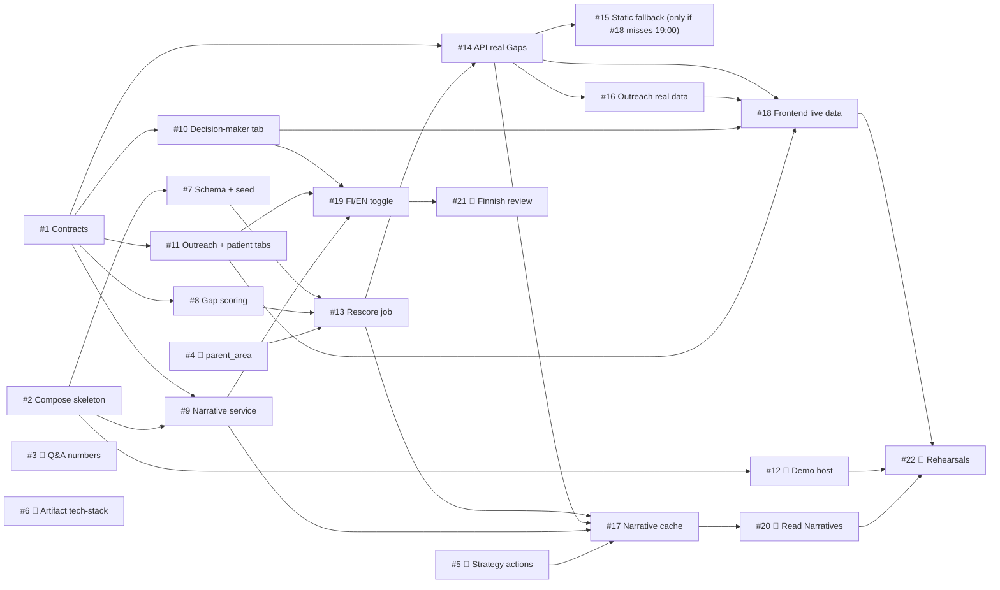

## Tickets

All work, for people and agents alike, is tracked as [GitHub Issues](https://github.com/balintpragai/Junction2026/issues). **The issues are the source of truth.** The graph below is a snapshot from when the backlog was created, so if it disagrees with an issue's "Blocked by" panel, the issue wins.

### Labels

| Label | Meaning |
|---|---|
| `ready-for-agent` | Fully specified. An AI agent can do it, with its owner approving the "Files to read" at the start of the session (see `AGENTS.md`). |
| `ready-for-human` | Needs a person: curation, review, deployment, rehearsal. |
| `needs-triage` | New, not yet looked at. Every new ticket starts here. |
| `needs-info` | Waiting on someone for more information. |
| `wontfix` | Decided against. |

### Dependencies

An arrow means "must be closed before". 🧑 marks a `ready-for-human` ticket.



Checkpoints on the path: **#14** is the 16:00 one (real Gaps served end to end), and **#18** is the 19:00 cut line (frontend on live data, otherwise start #15).

The commands below use the `gh` CLI. On Windows, if `gh` isn't on your PATH yet, restart your terminal or call `"C:\Program Files\GitHub CLI\gh.exe"`.

### Open a new ticket

```sh
gh issue create --title "Short, specific title" --label needs-triage \
  --blocked-by 13,14 \
  --body "## What to build
...
## Acceptance criteria
- [ ] ...
## Files to read
- ..."
```

- Leave out `--blocked-by` if nothing gates it.
- Every new ticket starts as `needs-triage`. Once it's fully specified, the coordinator relabels it `ready-for-agent` or `ready-for-human` and assigns it (`--add-assignee <login>`).
- Use the words in `GLOSSARY.md`, and list every file the work needs under **Files to read**. That list is what the owner approves when an agent starts.

### Start a ticket

1. **Check that it's unblocked.** It's ready when it has no open blockers (0 means go):
   ```sh
   gh issue view <n> --json blockedBy --jq '[.blockedBy.nodes[] | select(.state == "OPEN")] | length'
   ```
   To see everything assigned to you: `gh issue list --assignee @me --state open`
2. **Claim it** if it isn't already yours: `gh issue edit <n> --add-assignee @me`
3. **Branch off in your own worktree**, so parallel agents don't trip over each other:
   ```sh
   git fetch origin
   git worktree add ../Junction2026-issue-<n> -b issue-<n>-<slug> origin/main
   ```
4. **For an agent ticket**, open the agent in that worktree, point it at the issue, and in your first message approve each file under **Files to read** by name.

### Close a ticket

1. **Open a PR whose body says `Closes #<n>`.** GitHub then closes the issue automatically when the PR merges. Paste the ticket's proof (test output, `curl` output, screenshots) into the PR body.
   ```sh
   gh pr create --base main --title "#<n> <title>" --body "Closes #<n>
   ...proof..."
   ```
2. **The person who launched the agent reviews and merges.** Nobody pushes straight to `main`.
   ```sh
   gh pr merge <pr> --squash --delete-branch
   git worktree remove ../Junction2026-issue-<n>
   ```
3. **Closing without a PR** (human tickets, or a decision not to do it): comment first, then close. Use `--reason "not planned"` plus the `wontfix` label when it's dropped.
   ```sh
   gh issue comment <n> --body "What was done / why it's closed"
   gh issue close <n>
   ```

Closing a ticket automatically unblocks every ticket that was waiting on it.

